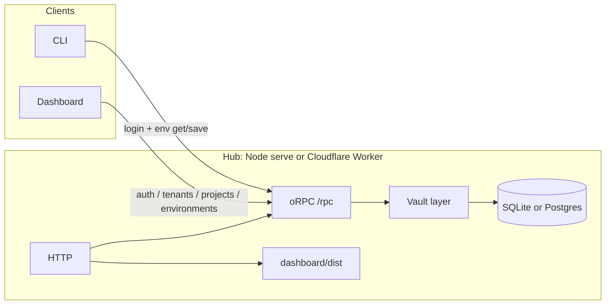

# Architecture

EnvVault is a small monorepo: a Node CLI/server package at the repo root, plus a Vite React dashboard under `dashboard/` (Tailwind + shadcn/ui).

## High-level



## Packages & entrypoints

| Area | Path | Role |
|---|---|---|
| CLI package | `packages/cli` | Published npm `envvault` (thin client) |
| Shared crypto | `packages/shared` | Private workspace lib (bundled into CLI) |
| Hub entry | `src/index.ts` | Local `serve` only |
| Server | `src/server.ts` | HTTP + oRPC + static UI |
| Worker | `src/cloudflare/worker.ts` | Cloudflare assets + oRPC |
| oRPC router | `src/rpc/router.ts` | Composes domain procedures |
| oRPC procedures | `src/rpc/procedures/` | `auth`, `admin`, `tenants`, `projects`, `environments` |
| oRPC base | `src/rpc/base.ts` | Auth middleware, ACL helpers |
| Runtime | `src/rpc/runtime.ts` | Signup (invites), login proof check, password change |
| Context | `src/rpc/context.ts` | Per-request `db` and headers |
| Zero-knowledge crypto | `packages/shared/src/zk.ts` | KDF, sealing, DEK wrap — runs in browser, CLI, Node, Workers |
| Login-proof hashing | `src/auth-proof.ts` | Salted/peppered HMAC of `authKey`, invite tokens |
| DB open | `src/db/index.ts` | SQLite / Postgres open |
| DB schema | `src/db/schema.ts` | Kysely table types |
| DB migrate | `src/db/migrate.ts` | `ensureSchema` |
| DB repos | `src/db/{users,tenants,projects,environments,settings}.ts` | Domain queries |
| DB barrel | `src/db/store.ts` | Re-exports for callers |
| Dashboard | `dashboard/src/` | React UI; client in `api.ts` |

## Tenancy model

| Kind | How created | Sharing |
|---|---|---|
| **Personal** | Automatic on signup (`slug` = username) | Solo; invites disabled |
| **Organization** | Settings → Create organization | Invite by username; unique `slug` |

Users and org slugs share one global namespace (case-insensitive). Soft cap: **10** orgs owned per user.

Membership: `tenant_members` with `role` (`owner` \| `admin` \| `member`) and `status` (`pending` \| `active`).

## Projects & environments

- A **project** is a container under a tenant.
- An **environment** (`default`, `staging`, …) holds the encrypted env map and has its own DEK + ACL.

| Table | Purpose |
|---|---|
| `users` | `kind` (`user` \| `service`), login-proof hash, KDF params, public key, sealed private key, recovery proof + recovery-sealed key, `role`, `status`, service-account workspace |
| `invites` | Single-use signup invites (token hash only) |
| `sessions` | Concurrent login tokens (CLI + dashboard) |
| `tenants` | `id`, unique `slug`, `kind` (`personal` \| `org`), owner |
| `tenant_members` | Membership + invite state |
| `projects` | Project metadata |
| `environments` | Per-env sealed `payload` (ciphertext only) |
| `environment_keys` | RSA-OAEP wrap of env DEK per user |
| `environment_acl` | `read` \| `write` \| `manage` per user per env, plus a `caps` list (`delete`, `share`, `rotate`; empty for `manage`, which has all three) |
| `audit_log` | Append-only activity (actor, action, target, IP — never values), each row HMAC-signed |
| `rate_limits` | DB-backed counters for login/signup/recovery throttling (shared across replicas) |
| `settings` | schema version, first-admin claim |

## Auth & crypto

Full detail and limitations: [Security](security.md).

1. **Login proof** — the client stretches the password (Argon2id 64 MiB / t=3 via `hash-wasm`; PBKDF2 600k also accepted; salt = username), derives `authKey` + `wrapKey` via HKDF, and sends only `authKey`. The server stores a salted (optionally peppered) HMAC of it.
2. **Identity keypair** — RSA-OAEP-3072; the private key is sealed with `wrapKey` client-side and returned at login for the client to open.
3. **Sessions** — SHA-256 hashed at rest, 30-day expiry; password change or disabling a user revokes them.
4. **Environment DEK** — random per environment, wrapped to each member's public key. Payloads are sealed client-side with AES-256-GCM; the server never gets the DEK.
5. **Recovery key** — random 256-bit key (shown once) that independently seals the private key; enables password reset.
6. **Key pinning** — clients remember public-key fingerprints (TOFU) and refuse silent key changes.
7. **Service accounts** — machine users authenticated by an expiring token that embeds their own private key.
8. **Signup** — first account becomes administrator; afterwards `ENVVAULT_SIGNUP` = `invite` (default), `open`, or `closed`. Invites are admin-issued, single-use, expiring.

## oRPC surface (`/rpc`)

| Area | Procedures (summary) |
|---|---|
| Public | `health`, `status`, `prelogin`, `signup`, `login`, `recovery.bundle`, `recovery.recover` |
| Account | `me`, `changePassword`, `recovery.set`, `sessions.{list,revoke,revokeOthers}` |
| Users | `users.resolve` |
| Admin (instance admins) | `admin.users.{list,setStatus,setRole}`, `admin.invites.{create,list,revoke}`, `admin.audit.{list,verify}` |
| Service accounts | `serviceAccounts.{create,list,revoke}` (workspace owners/admins) |
| Tenants | `list`, `create`, `members`, `invite`, `invites`, `acceptInvite`, `declineInvite`, `removeMember` (returns environments to rotate), `delete`, `keyRecipients`, `audit` |
| Projects | `list`, `create`, `delete` |
| Environments | `list`, `create`, `delete`, `getEnv`, `saveEnv` (optimistic `baseUpdatedAt`), `rotate`, `grantAccess`, `listAccess` |

CORS allows `Authorization` and `Content-Type`.

## Encryption path

```text
EnvMap → JSON → AES-256-GCM(envDek, AAD=tenant|project|env) → environments.payload   (in the client)
envDek → RSA-OAEP(userPublicKey) → environment_keys.wrapped_env_dek                  (in the client)
```

## Dashboard ↔ server

`dashboard/src/api.ts` builds an oRPC client against the **page origin** `/rpc`. Vite proxies `/rpc` → `http://127.0.0.1:3847`. Production: `pnpm build:dashboard` → `dashboard/dist`, served by `envvault serve` or the Cloudflare Worker.

UI stack: React 19, Tailwind CSS 4, shadcn-style components.

## Storage backends

| Mode | How |
|---|---|
| Local SQLite | default `.envvault/vault.db` (cwd), or `ENVVAULT_DB` |
| Postgres | `DATABASE_URL` (env only) |
| Cloudflare Worker | Hyperdrive or `DATABASE_URL` + static assets |

See [cloudflare.md](cloudflare.md).
